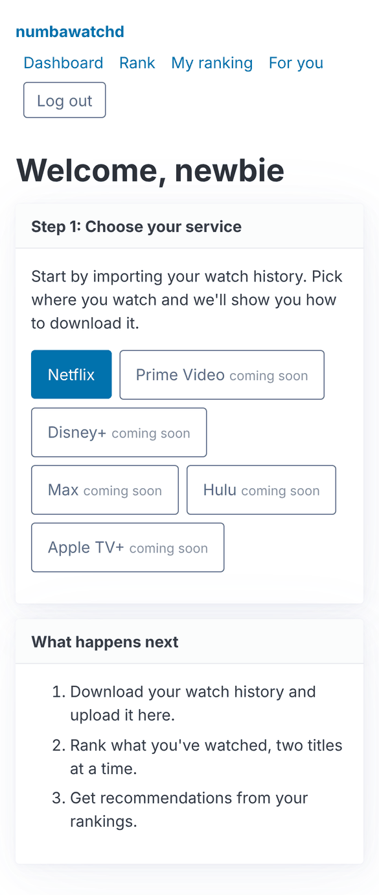
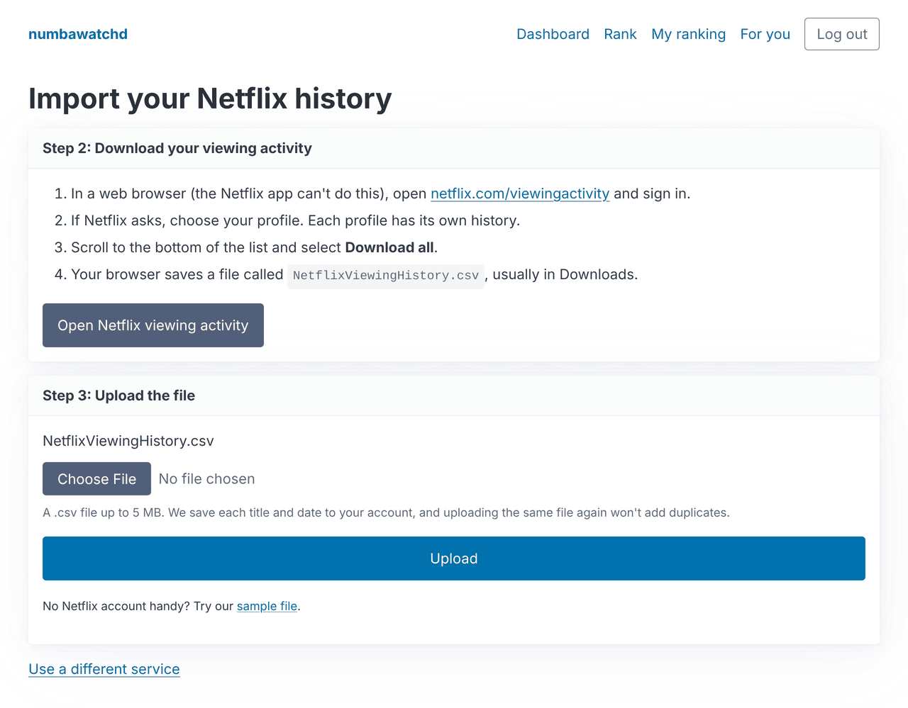
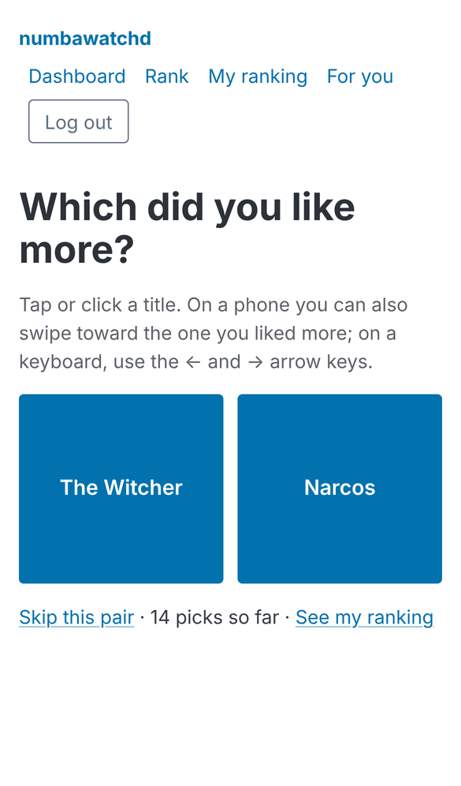

# Sprint 2: Import, rank, and production

## Sprint goal

A new user can import their Netflix history and start ranking what they've
watched, and the first AI feature exists. Production is running with its own
database, and moving a change to it is a deliberate step.

## What shipped

- **Find my watch-history download page**
  ([#2](https://github.com/R-G-8/sparkling-shape-repo/issues/2)). A new user's
  dashboard opens on "Step 1: Choose your service". Netflix shows step-by-step
  download instructions and a link to `netflix.com/viewingactivity`; Prime
  Video, Disney+, Max, Hulu and Apple TV+ show "coming soon".
- **Upload my Netflix watch history**
  ([#3](https://github.com/R-G-8/sparkling-shape-repo/issues/3)). Upload a
  `.csv` of up to 5 MB. Each Title/Date row is saved to the database for that
  user, and re-uploading adds no duplicates. A malformed file saves nothing,
  and the error names the bad row. After the upload you see how many titles
  were imported. Episodes are grouped under their show, so you rank *Squid
  Game*, not "Season 1: Red Light, Green Light". A sample file is linked on the
  page for anyone without Netflix.
- **Rank what I've watched**
  ([#4](https://github.com/R-G-8/sparkling-shape-repo/issues/4)). `/rank/`
  shows two of your titles; tap or click the one you liked more (swipe on a
  phone, or use the arrow keys on a computer). Each pick updates an Elo
  rating, and `/rankings/` lists your titles in that order. New pairs prefer
  titles you haven't compared yet.
- **AI recommendations, started**
  ([#6](https://github.com/R-G-8/sparkling-shape-repo/issues/6)).
  `/recommendations/` sends your top-ranked titles to OpenRouter, from the
  server only, and asks for JSON that follows a schema. It drops anything
  you've already watched, needs at least five recommendations each with a
  one-line reason, caps each user at 10 calls a day, and shows a friendly
  message on any failure. Tested with the LLM mocked. Not yet tried with the
  course key, so #6 stays open.
- **Production:** a second Render service (`numbawatchd`) with its own Neon
  database. It deploys the `production` branch, which moves only when someone
  runs the **Promote to production** GitHub Action, and only for a commit
  whose CI passed.
- **Seed demo data:** `seed` now loads the sample history into the admin
  grader account, and it's still safe to rerun.
- 79 automated tests, up from 18. They pass on Postgres (CI) and SQLite.

## What works on staging now

Staging: https://numbawatchd-staging.onrender.com

- [`/signup`](https://numbawatchd-staging.onrender.com/signup/) leads to the
  dashboard's "Choose your service" step
- [`/import/netflix/`](https://numbawatchd-staging.onrender.com/import/netflix/):
  download guide and upload
- [`/rank/`](https://numbawatchd-staging.onrender.com/rank/) and
  [`/rankings/`](https://numbawatchd-staging.onrender.com/rankings/)
- [`/recommendations/`](https://numbawatchd-staging.onrender.com/recommendations/)
  (needs `OPENROUTER_API_KEY` on Render)
- Still working: [`/e1531ff`](https://numbawatchd-staging.onrender.com/e1531ff),
  [`/e1531ff/stats`](https://numbawatchd-staging.onrender.com/e1531ff/stats),
  [`/healthz`](https://numbawatchd-staging.onrender.com/healthz)

Production: https://numbawatchd.onrender.com

| Choose your service (phone) | Netflix import | Ranking (phone) |
|---|---|---|
|  |  |  |

## Working with our agents

We pointed Claude Code at the issues' acceptance criteria and the course
requirements, and it wrote one test per criterion. Its first version of "group
episodes under their show" passed all of its own tests. Then it printed the
shows it found in a realistic Netflix file, and one was wrong: Netflix names
later seasons "Stranger Things: Stranger Things 4: Chapter One", which became
a separate show from "Stranger Things". It added a rule for that pattern and a
test using real Netflix titles. The course requirements also showed that
Sprint 2 expects the AI feature started, which our Sprint 1 plan had missed.
Lesson: tests an agent writes from its own examples only check what it
already expected. Running it on real data, and against the real requirements,
caught the gaps.

## Backlog changes for next sprint

- Added [#6](https://github.com/R-G-8/sparkling-shape-repo/issues/6) (AI
  recommendations) to the Sprint 2 iteration, since the course asks for the AI
  feature to be started this sprint. It moves to Sprint 3 until it works on
  staging with the course OpenRouter key.
- Sprint 3 commitment: finish #6 on staging;
  [#5](https://github.com/R-G-8/sparkling-shape-repo/issues/5) title details
  from an external movie source, cached;
  [#7](https://github.com/R-G-8/sparkling-shape-repo/issues/7) follow friends.
- Technical-challenge items for Sprint 3: make CI a required check, add an
  evaluation set for the recommendation prompt, and move the browser
  walkthrough into CI.
